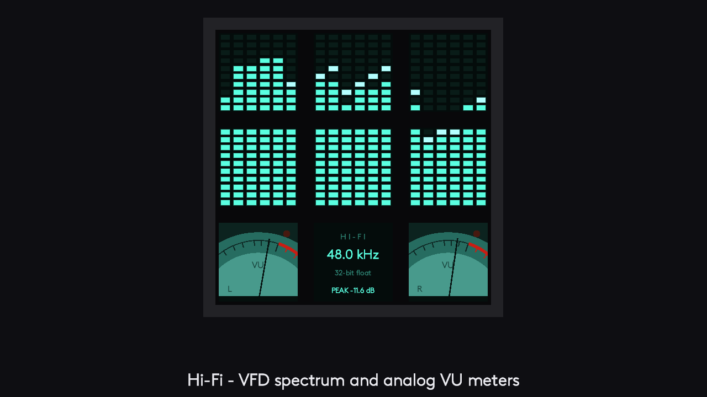
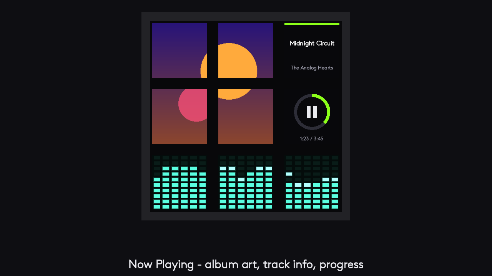
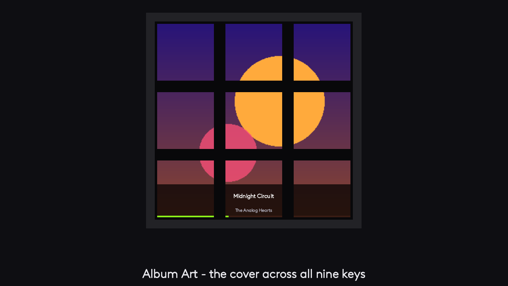
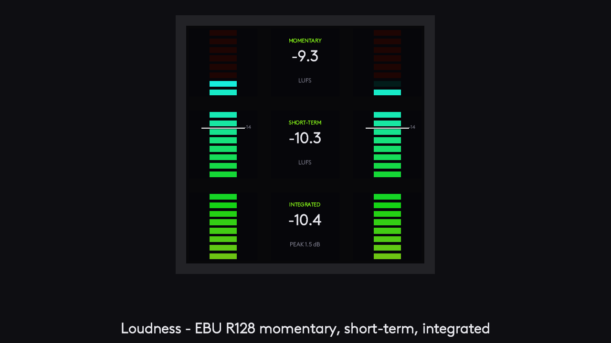
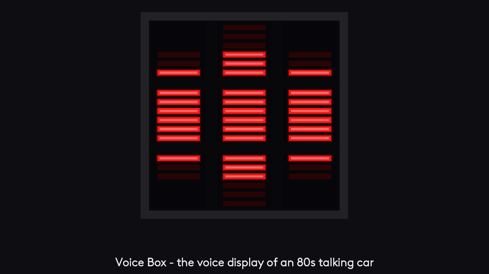
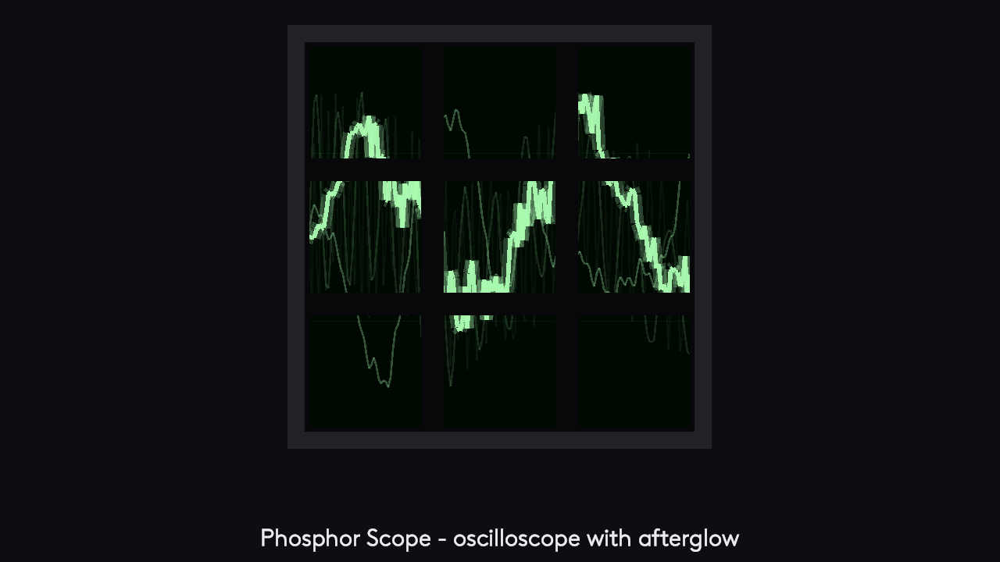
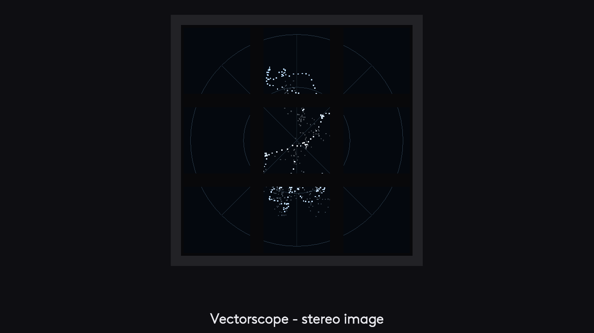
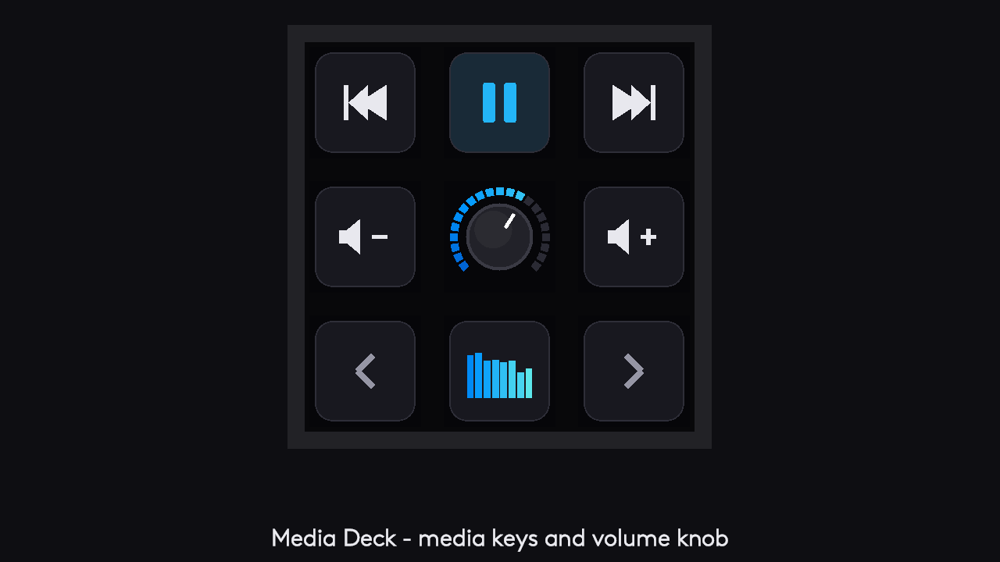
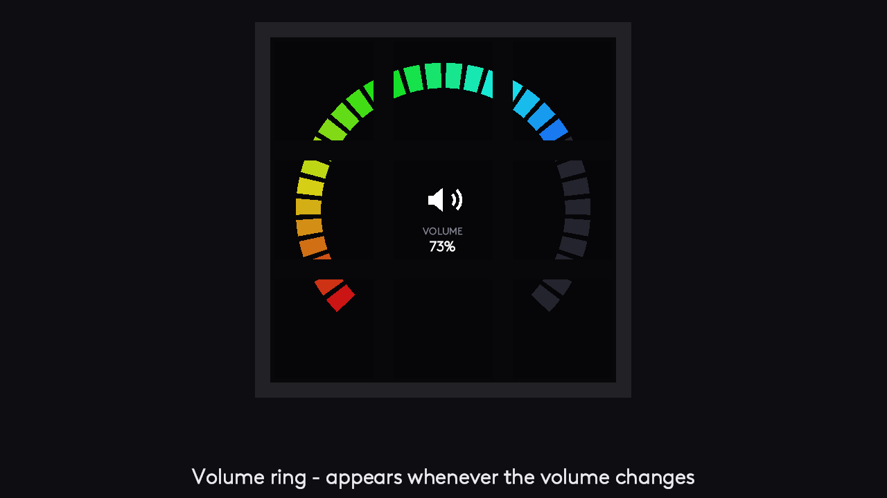

# Audio Visualizer – user guide

Audio Visualizer turns the LCD keys of the **Logitech MX Creative Keypad** into one live display that moves with whatever your PC plays. It also has keys for media, volume, microphone and output device, and dials for the **MX Creative Dialpad**.



**Contents**

1. [What you need](#what-you-need)
2. [Getting started](#getting-started)
3. [What a visualizer key does when you press it](#what-a-visualizer-key-does-when-you-press-it)
4. [Giving keys your own actions](#giving-keys-your-own-actions)
5. [The visualizations](#the-visualizations)
6. [Themes and display settings](#themes-and-display-settings)
7. [Dashboard and control keys](#dashboard-and-control-keys)
8. [MX Creative Dialpad](#mx-creative-dialpad)
9. [Balance, output and microphone](#balance-output-and-microphone)
10. [When something is wrong](#when-something-is-wrong)
11. [Privacy](#privacy)

## What you need

- Windows 10 or 11. macOS is not supported.
- Logi Options+ with Logi Plugin Service 6.4 or later.
- An MX Creative Keypad. The Dialpad is optional.

Install Audio Visualizer from the Logi Marketplace. It then appears in Logi Options+ in the action list of the keypad.

## Getting started

1. In Logi Options+, open the MX Creative Keypad and find **Audio Visualizer** in the action list.
2. Open the **Visualizer** group and drag **3x3 – key 1** to **3x3 – key 9** onto the keys in reading order:
   ```
   1 2 3
   4 5 6
   7 8 9
   ```
3. Play some music.

The nine keys now show one picture. Bars, waves and circles run from key to key, and the gaps between the keys are accounted for, so shapes line up.

**Smaller layouts.** You don't have to give up the whole page:

| Layout | Actions to place | Keys |
|---|---|---|
| Whole keypad | 3x3 – key 1 … 9 | all nine |
| Two rows | 3x2 – key 1 … 6 | two rows next to each other, in reading order |
| One row | Row 3x1 – key 1 … 3 | three keys in a row |
| One key | Single key | the whole visualizer on one key |

Every visualization has its own picture for each layout.

**Don't change a visualizer key's icon, layout or text in Options+.** The plugin already fills the key and shows no title. If you edit the icon, Options+ saves a still picture in its place and the key stops moving. To fix a key that has stopped, reset its icon in Options+.

## What a visualizer key does when you press it

A visualizer key acts by its place in the group:

| Layout | Top row | Middle row | Bottom row |
|---|---|---|---|
| **3x3** | Volume down · **position actions on/off** · Volume up | Previous track · Play / pause · Next track | Previous visualization · Next theme · Next visualization |
| **3x2** | Previous track · Play / pause · Next track | | Previous visualization · Next theme · Next visualization |
| **Row 3x1** | | | Previous visualization · Next theme · Next visualization |
| **Single key** | Next visualization | | |

So with the 3x3 layout, the bottom corners step through the visualizations and the bottom center key changes the colors.

A few visualizations give their keys fixed jobs while they are shown: **Media Deck** (each key does what its icon shows), the play key in **Now Playing**, and the reset key in **Loudness**.

## Giving keys your own actions

Options+ cannot show a settings window for live keys, so you choose the actions on the keypad itself:

1. Place **Visualizer controls → Keys – edit actions** on a free key and press it. Every visualizer key now shows *PRESS = …* with its current action.
2. Press a visualizer key to step to its next action. The choices come in this order:
   - visualizer: visualization, theme, beat colors, sensitivity, freeze, frame rate, idle screen, loudness reset
   - media: play / pause, previous, next
   - audio: volume up / down / mute, balance left / right / center, output switch, microphone up / down / mute
   - nothing
3. Press **Keys – edit actions** again, or wait 30 seconds, to go back to the visualizer.

Each key remembers its own action. A key you did not change keeps the action of its place.

**Switching back.** **Visualizer controls → Keys – position actions** switches between *by position* and *your own*. In the 3x3 layout the top center key does the same, until you give that key another action.

## The visualizations

| Visualization | What you see |
|---|---|
| **Spectrum** | LED bars with falling peaks |
| **Mirror** | Bars growing up and down from the center |
| **Scope** | The live waveform, like an oscilloscope |
| **Phosphor Scope** | An oscilloscope whose traces glow and fade |
| **Radial** | A circular spectrum around a core that pulses with the bass |
| **Waterfall** | A scrolling spectrogram |
| **Pulse** | Every key lights up for its own frequency range |
| **VU Meter** | Stereo LED level meters |
| **Vertical VU** | Tall mixing-console meters: left channel in the left column, right in the right, a dB scale between them |
| **Loudness** | An EBU R128 loudness meter: momentary, short-term and integrated LUFS, with the −14 LUFS streaming target marked and sample peak. The integrated key (bottom center) resets the measurement. |
| **Hi-Fi** | An 80s hi-fi look: glowing spectrum display, analog VU needle meters and a readout of sample rate, bit depth and peak |
| **Hi-Fi Studio** | The Hi-Fi meters under fine striped bars with a reflection |
| **Now Playing** | Album cover over four keys, title and artist, a progress ring (press it for play / pause) and a spectrum underneath |
| **Album Art** | The cover across all nine keys, with a short title caption when the track changes |
| **Media Deck** | Media buttons with icons around a volume knob |
| **Studio** | Fine striped bars, their reflection, and left / right level bars |
| **Late Drops** | Peak caps hang in the air, then fall |
| **Vectorscope** | The stereo image of your music: mono is a vertical line, wide stereo spreads sideways |
| **Beat Burst** | Every bass hit launches particles and rings across the keys |
| **Voice Box** | The voice display of an 80s talking car: three columns of red LED bars that jump with every word and beat |

| | |
|---|---|
|  |  |
|  |  |
|  |  |

**Media Deck keys.** In this visualization the keys do what their icons show:

```
previous track     play / pause       next track
volume down        knob: mute         volume up
previous           mini spectrum:     next
visualization      next theme         visualization
```



On a single row the keys are play / pause, the knob (mute) and next visualization. On two rows you get the top two rows of the deck, and pressing the knob goes to the next visualization.

**Now Playing and Album Art** show what Windows reports as the current track (Spotify, browsers, most players). When a track has no cover, a spinning vinyl record takes its place. If no app reports a track, the keys show "Nothing playing".

**Volume ring.** Whenever the volume changes, from the keypad, the keyboard or Windows, the whole group briefly becomes one big volume ring with the percentage in the middle.



## Themes and display settings

All of these are keys in the **Visualizer controls** group. Each shows its current setting, and everything is remembered between sessions.

| Key | What it does |
|---|---|
| **Mode – next / previous** | Steps through the visualizations. The key shows the one it switches to. |
| **Theme – next** | Rainbow, Synthwave, Fire, Ocean, Matrix, Ice, Mono (gray tones), Amber, Sunset, Aurora, Neon, Red |
| **Theme – beat-synced colors** | Shifts the theme's colors a step with every beat |
| **Display – sensitivity** | Auto (quiet and loud music both fill the display) or a fixed 0.6x to 2.5x |
| **Display – frame rate** | Full, half or a third of the pictures. Lower rates use less CPU; the animation speed stays the same. |
| **Display – freeze** | Holds the current picture |
| **Display – idle screen** | What the keys show after 30 seconds of silence: a digital clock, an analog clock, a calm animation, or nothing special (Off) |
| **Keys – edit actions** | See [Giving keys your own actions](#giving-keys-your-own-actions) |
| **Keys – position actions** | Switches visualizer keys between acting by position and your own actions |
| **Loudness – reset** | Starts the integrated loudness measurement again |

Media Deck, Now Playing, Album Art and Loudness stay on screen during silence.

## Dashboard and control keys

You can mix visualizer keys with single-purpose keys, for example a one-row visualizer on top and media keys below. These keys look the same in every visualization.

**Dashboard group**

| Key | Shows | Press |
|---|---|---|
| Track – cover | The album cover (dimmed while paused) | Play / pause |
| Track – title · Track – artist + album | Text | Play / pause |
| Track – time | Elapsed time, remaining time, progress bar | Play / pause |
| Track – banner (1 key, 2-wide, 3-wide) | One display across the keys: title, artist and album, elapsed and remaining time, progress bar. Long titles scroll. Place the keys of a banner next to each other in order. | 3-wide: previous · play / pause · next. 2-wide: play / pause · next. 1 key: play / pause |
| Volume gauge | The live output level on a ring | Mute |
| Microphone gauge | The live microphone level while an app uses the microphone | Mute |
| Balance gauge | A ring that lights towards the side the balance leans to | Center |
| Loudness meter | Short-term and integrated LUFS | Reset |
| Clock – digital · Clock – analog | Time and date, or a clock face | – |

**Media controls group:** Track – play / pause (with a progress ring and the time), Track – previous, Track – next.

**Audio controls group**

| Key | What it does |
|---|---|
| Volume – down / mute / up | System volume. The mute key shows a red cross while muted. |
| Balance – left / center / right | Moves the sound between the speakers. The line on the center key is red while the balance is centered. |
| Microphone – down / mute / up | Level and mute of the default microphone. The mute key turns red while muted. |
| Output – switch | Goes to the next output device (speakers, headphones, monitor) and shows its name |

## MX Creative Dialpad

A plugin cannot take over a Dialpad dial by itself. Options+ offers another way: **put a dial action on a keypad key.** The key shows what the dial controls, and pressing it hands the Dialpad dial to that function. Options+ marks the key while it holds the dial.

| Dial action | Group | Turning the dial |
|---|---|---|
| **Mode – dial** | Visualizer controls | Previous / next visualization |
| **Theme – dial** | Visualizer controls | Previous / next theme |
| **Track – dial** | Media controls | Previous / next track |
| **Track – seek dial** | Media controls | 5 seconds back / forward in the track |
| **Volume – dial** | Audio controls | System volume in 2% steps |
| **Balance – dial** | Audio controls | 5% steps; it stops at center on the way across |
| **Microphone – level dial** | Audio controls | Microphone level in 2% steps |
| **Output – dial** | Audio controls | Previous / next output device |

Turning volume, microphone level or balance shows the value as a large gauge over the whole visualizer for a moment.

**Visualizer dial keys.** The **Visualizer dials** group has every layout (3x3, 3x2, Row 3x1, Single key) once more as dial actions. They show the same live picture; pressing one hands the dial to the job of that key's place:

| Key's place | Turning the dial |
|---|---|
| Visualization keys, Single key | Previous / next visualization |
| Theme key | Previous / next theme |
| Previous / next track keys | Previous / next track |
| Play / pause key | 5 seconds back / forward in the track |
| Volume keys and the 3x3 top center key | System volume |

With position actions switched off, every visualizer dial key turns the visualization. These keys have no press action of their own, because Options+ uses the press to hand over the dial.

Seeking works with players that allow it through Windows; others ignore it.

## Balance, output and microphone

- **Balance** changes the real Windows left and right levels and keeps the louder side, so the overall volume stays the same. On 5.1 and 7.1 outputs it moves all left / right pairs and leaves center and subwoofer alone.
- **Outputs without a left / right control** (many HDMI and DisplayPort monitors) are balanced per app instead. Windows remembers these per-app levels, so **center the balance before you uninstall the plugin**.
- **Output – switch** sets the Windows default output, like the Windows sound settings do. The visualizer follows on its own.
- **The microphone is never opened.** The level comes from the Windows level meter, so it moves only while another app (Teams, Zoom, OBS) uses the microphone, and the Windows "microphone in use" sign stays off.

## When something is wrong

**The keys stay dark while music plays, or show "Exclusive audio mode".**
Some players take the output device for themselves ("exclusive mode", "bit-perfect", "bypass"). Windows then has nothing to hand to the visualizer. Turn that option off in the player, or untick *Allow applications to take exclusive control of this device* in the Windows sound settings of the output. The visualizer comes back within seconds.

**The keys show their action names instead of pictures.**
Restart Logi Plugin Service (end it in Task Manager; it starts again on its own), or restart the computer.

**One key has stopped moving while the others move.**
Its icon was edited in Options+. Reset the icon there.

**The keys show a clock instead of the visualizer.**
That is the idle screen, shown after 30 seconds of silence. It goes away when sound plays. Turn it off with **Display – idle screen**.

**The visualizer disappears when I click another window.**
Your keypad has a profile for that app with other keys on it. Place the visualizer keys in that profile too, or in the default profile.

**Now Playing shows "Nothing playing".**
The player does not report its track to Windows. Other visualizations still work.

**The picture looks less smooth with nine keys than with three.**
The keypad takes a limited number of pictures per second, shared by all keys on screen. The plugin shows fewer frames rather than late ones, so the picture always stays in step with the sound.

**Anything else:** [open an issue](../../issues/new). The [front page](README.md) says what to include and how to send a log.

## Privacy

The plugin reads the sound your PC plays and the current track's title and cover only to draw them on the keys. Nothing is recorded, saved, logged or sent anywhere. The terms are in the [End-User Licence Agreement](EULA.md).
